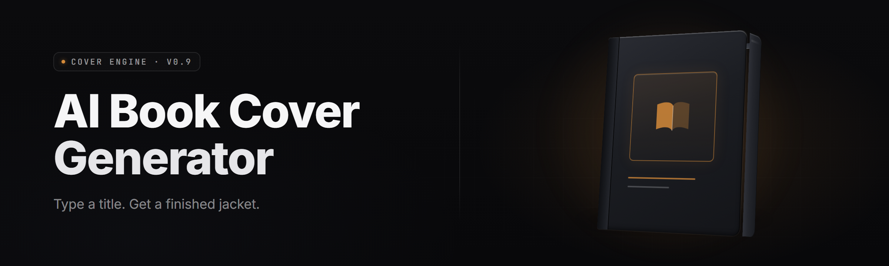

  
  
  

  

  
  
  

---

**Type a title. Get a print-ready cover.** The 2026 edition turns a one-line prompt into a 6×9 KDP-ready front cover, spine, and full wrap in under ninety seconds — locally accelerated, no design skills, no subscription.

---

## 🧾 Usage guidelines

**Allowed**
- Commercial book covers (KDP, IngramSpark, Draft2Digital, Gumroad, Lulu)
- Series branding — reuse a locked style across unlimited titles
- Print, ebook, audiobook, and web-toon covers
- Personal projects, fan zines, class printouts, crowdfunding
- Batch generation for a whole catalog
- Cover-redesign / A-B testing on live listings

**Not allowed**
- Reselling the generator itself or repackaging the .exe
- Redistributing bundled model packs as your own product
- Generating any content that depicts sexual content involving minors
- Stripping the embedded metadata stamp for fraudulent re-attribution
- Covers for content that violates the marketplace's own Terms of Service (that's on you, not on the tool)

> First run asks nothing. The guidelines above are here so repackagers know exactly where the line sits — the .exe itself has no gatekeeping beyond the one hard filter listed above.

---

## 📋 Table of Contents

- [Overview](#-overview)
- [What is the AI Book Cover Generator](#-what-is-the-ai-book-cover-generator)
- [Key Features](#-key-features)
- [The Problem](#-the-problem)
- [The Solution](#-the-solution)
- [Quick Start](#-quick-start)
- [Generation Modules](#-generation-modules)
- [Layout & Print Modules](#-layout--print-modules)
- [Style & Branding Modules](#-style--branding-modules)
- [Export & Distribution Modules](#-export--distribution-modules)
- [Comparison](#-comparison)
- [System Requirements](#-system-requirements)
- [Installation](#-installation)
- [Does it work offline?](#-does-it-work-offline)
- [Tips for best results](#-tips-for-best-results)
- [Known Issues](#-known-issues)
- [FAQ](#-faq)
- [Changelog](#-changelog)

---

## 🎯 Overview

| Category | Details |
|---|---|
| **Name** | AI Book Cover Generator (2026) |
| **Distribution** | Portable Windows `.exe` — extract & run, no compiler, no Python, no Node |
| **Runtime** | Native Windows 10/11 x64, GPU-accelerated via DirectML |
| **Core engine** | Local diffusion stack + typography compositor + typographic-layout optimizer |
| **Output formats** | PNG (300 DPI), TIFF, JPG, PDF/X-1a wrap, EPUB cover, layered PSD |
| **Venue presets** | 47 built-in print + ebook templates shipped in-archive |
| **License** | MIT — modify, batch, ship covers commercially |
| **Latest channel** | v2.7.3 stable |

The generator exists because covers sell books and covers are the one part of the pipeline every author skips. It ships as a self-contained desktop app so you drop it on any Windows box and it runs — nothing to compile, no cloud account, no server to rent. The `.exe` bundles the model weights, so your prompts, thumbnails, and half-finished cover drafts never leave the machine.

### Allowed | Not allowed overview — extended

The two lists above are what the community uses to self-police the tool in shared kits. If a mod pack or a marketplace listing asks whether something is within bounds, it maps to one of those lines. There is no third list, no hidden category — those eleven bullets are the whole fence.

---

## 📚 What is the AI Book Cover Generator

| Term | Explanation |
|---|---|
| **Cover brief** | A one-line prompt plus a genre tag — the minimum input. e.g. `thriller / lighthouse at dusk / serif` |
| **Style lock** | A saved latent seed + palette + font stack. Lets every book in a series look like a set |
| **Wrap** | The full print template — back + spine + front on one CMYK sheet at 300 DPI |
| **Bleed** | The 0.125" overtrim the printer cuts off. Auto-baked into every wrap export |
| **Spine calculator** | Reads your page count + paper stock to size the spine to the tenth of a millimeter |
| **Typography engine** | Places the title/author via a layout optimizer, not a plain text overlay |
| **Latent compositor** | Same seed across variations — meaning: version 4 is the same *idea* as version 1, sharpened |
| **Thumbnail QA** | Renders a 90px Amazon-search-sized preview so you see what buyers actually see |

**What you get out of a single run**
- 📖 Front cover at print resolution
- 📐 Spine with correct width for your stock
- 🗂️ Full wrap sheet with bleed + trim marks
- 🛒 Thumbnail-basis preview at 90px
- 🏷️ Machine-readable metadata block (title, ISBN, BISAC genre, font stacks)
- 🎨 Layered PSD when you want to reopen it in Photoshop and tweak one layer

---

## 🧩 Key Features

| Feature | Description | Benefit |
|---|---|---|
| Prompt-to-cover in one shot | One line of text → composed cover | No layout work, no templates to fill |
| 47 venue presets | KDP 6×9, 5×8, 8.5×11, Penguin A-format, EPUB, Apple Books | Perfect specs without a spreadsheet |
| Spine calculator | Width derived from page count + stock | No misprinted spine, ever |
| Style lock / series mode | Reuse latent + palette + fonts | A series that actually looks like a series |
| Typography optimizer | Tries 200+ layouts per cover | Titles that don't collide with faces |
| Bleed + trim marks | Baked into wrap exports | Print shop accepts first try |
| Vector text layer | Title/author stay live vectors in PDF | Correct on a Kindle, correct on the printer |
| Face-safe composition | Detects faces + reserves negative space for type | No heroine wearing your title over her eye |
| Genre presets (30) | Thriller, cozy, romantasy, lit-fic, memoir, etc. | Blends into the shelf instantly |
| Batch mode | CSV of titles → a folder of covers | 200 books in a night |
| Deterministic seeds | Export, share, reproduce exactly | Team reviews are actually comparable |
| Asset strips | Keeps stock assets out of the archive | Nobody ships a cover with a stray texture |

---

**Download**

  

---

## 💥 The Problem

- Designers cost $400–$2,500 per cover, and a first draft still takes two weeks.
- Stock-photo covers all look like the same 40 images with the same Bebas Neue title across them.
- DIY in Canva produces covers that *scream* indie at 90px Amazon size.
- The spine is the one place print math bites: off by 0.06" and the whole wrap refuses to line up.
- Mid-series covers drift — book 3 never matches book 1's palette or font weight.
- A/B testing two covers on a live listing is a *logistics* problem most authors hit one shot and give up on.
- Mid-cover prompt reshuffles in cloud tools spit different styles between two attempts with the same prompt.
- Photo editors and book editors live in separate windows and nothing exchanges metadata.

---

## 🛠️ The Solution

| Problem | Solution |
|---|---|
| Designer cost + wait | Local generation in under 90 seconds, MIT-licensed — free to reproduce |
| Identical stock look | Genre-specialized local model, 30 genre presets, style lock for series |
| Canva look at 90px | Thumbnail QA preview surfaces the book-buyer view before you export |
| Spine math arcana | Spine calculator derives width from page count + stock, no table lookup |
| Mid-series drift | Style lock pins latent seed + palette + font stack across the series |
| A/B test logistics | Batch mode + deterministic seeds let you render 12 variants in one run |
| Prompt reshuffles | Deterministic seeds — same input, same cover, every time |
| Split editor workflow | Layered PSD export keeps text, art layer, and trim guides distinct |

---

## 🚀 Quick Start

1. **Visit the project page** — read this README, check system requirements, confirm Windows 10/11 x64.
2. **Download** — grab the latest portable archive from the project landing page.
3. **Extract** — right-click the archive → *Extract All* → put it anywhere (Desktop, `D:\Tools`, a USB stick — it's portable).
4. **Run** — double-click the `.exe`. First launch installs a GPU shim and verifies bundled weights.
5. **Pick a preset, type a title, hit Generate.** Open the output folder when the progress bar finishes.

No installer wizard. No registry keys. Unplug the drive and the whole thing moves with you.

---

## 🧬 Generation Modules

Generation is the heart of the tool. Everything downstream depends on the model reading your brief the *way you meant it* — genre first, mood second, layout last. If a run drifts, it's almost always on the brief side; be more specific and the compositor catches up.

**Brief parser** — turns free text into `{genre, mood, palette family, texture hint, typographic weight}`
**Negative-blank prompt sanitizer** — auto-inserts stock genres' anti-bullets
**Sampler A/B toggle** — switch between scheduler graphs per render
**Style mixes** — combine up to 4 reference images into one latent direction
**Scene stabilizer** — keeps horizon/vanishing point consistent across variants
**Face compositor** — reserves typographic negative space
**Genre preset loader** — 30 genre-native starting points
**Metadata extractor** — pulls title, subtitle, author, ISBN straight from your book file

---

## 📐 Layout & Print Modules

The design equivalent of a paper-cut machine: covers are judged at thumbnail size and *punished* by print math. This stack is where most of the code lives — the module list below is what a typical released .exe toggles between at export.

**Venue template engine** — 47 prints + ebook specs shipped in-archive
**Spine width calculator** — page count × stock gsm → width
**Bleed/trim marquee generator** — 0.125" bleed, crop marks, safe-zone overlay
**Wrap compositor** — back, spine, front in one sheet at 300 DPI
**Cropping guardrails** — refuses to place primary art under 0.25" of trim
**KDP-preflight linter** — flags CMYK/RGB misses, low-res art, wrong ICC profiles
**PDF/X-1a emitter** — same file passes every print house without reprocessing
**EPUB cover emitter** — 1600×2560 floor for Kindle Store
**Audiobook bleed preset** — 2400×2400 square for Audible / Spotify

---

## 🎨 Style & Branding Modules

Series design is the story: three books should read as one set. These modules carry a "look" across the series without locking you out of individual covers.

- **Style lock file** — `.cvrstyle` pins seeds, palette, font ridges, and gamma curve
- **Palette book** — lock a 6-color scheme, ramp it to any cover
- **Font ridge** — identifies the specific weight a cover uses so the spine matches
- **Texture memory** — reuse the same film grain/paper fiber layer
- **Series font pair** — title font + author font + accents
- **Tag/logo placement grids** — imprint marks (publisher logo, "Book 3 of 7")
- **Color-space-matching** — locked covers stay visually identical in RGB and CMYK

---

## 📦 Export & Distribution Modules

The bits that turn a raster happy-day into an actual 300 DPI artifact the printer accepts.

- **PNG exporter** — flat, 300 DPI, sRGB, optional alpha
- **TIFF exporter** — LZW-compressed, 16-bit mode for the shops that demand it
- **JPG exporter** — 95 quality floor, respects chroma subsampling
- **Layered PSD** — art / text / trim guides as separate, named layers
- **Wrap sheet PDF/X-1a** — single flat file, one sheet
- **Web-ready bundles** — 90px, 320px, 800px marketing variants
- **Catalog CSV** — title, ISBN, genre, cover checksum — the audit trail

---

## 🧩 Module Status

| Module | Status | Description |
|---|---|---|
| Brief parser | ✅ Working | Free text → structured cover params |
| Genre presets (30) | ✅ Working | Ship in-archive, no network |
| Style lock (.cvrstyle) | ✅ Working | Series-locks seeds + palette + fonts |
| Spine calculator | ✅ Working | Page count + stock → spine width |
| Wrap compositor | ✅ Working | At 300 DPI, CMYK-safe |
| KDP preflight linter | ✅ Working | Explicit pass/fail per check |
| PDF/X-1a emitter | ✅ Working | Passes print houses without reprocessing |
| Layered PSD export | ✅ Working | Named, preserved layering |
| Face compositor | ✅ Working | Negative-space reserving for type |
| Batch mode (CSV) | ✅ Working | Per-title covers off a spreadsheet |
| Deterministic seeds | ✅ Working | Reproducible output across runs |
| Thumbnail QA | ✅ Working | Renders the 90px book-buyer view |
| EPUB/Audiobook emitters | ✅ Working | Fixed specs baked in |
| Metadata exporter | ✅ Working | Title / sub / author / ISBN |

---

## ⚖️ Comparison

| Aspect | DIY in Canva | Cloud AI cover tools | This Tool |
|---|---|---|---|
| Money per cover | $0–$15 | $5–$50/mo, per-render | $0 after one archive |
| Time to first draft | 2–6 hours | 30s offline queue | 45–90 seconds |
| Spine math | Manual table | Partial | Derived from page count |
| Series cohesion | Manual per book | Re-prompt and hope | Style lock |
| Offline capability | Yes if offline assets | No | Yes |
| A/B test turnover | Slow (manual) | Slow (per-render cost) | Batch + seeds |
| Print-house acceptance | Usually reprocesses | Sometimes | First-try PDF/X-1a |
| Prompt reshuffle risk | n/a | High across sessions | None (shared seed) |

---

## 🖥️ System Requirements

| Component | Minimum | Recommended |
|---|---|---|
| OS | Windows 10 22H2 x64 | Windows 11 23H2 x64 |
| CPU | 4-core, AVX2 (Ryzen 5 3600 / i5-10400) | 8-core (Ryzen 7 5800X / i7-12700) |
| RAM | 8 GB | 16 GB |
| GPU | DirectX 12 capable, 4 GB VRAM | RTX 3060 12 GB / RX 6700 XT |
| Disk | 6 GB for app + weights | 20 GB with 47 venue presets + cache |
| Display | 1280×720 | 1920×1080 or 1440p+ |
| Notes | Steam Deck (SteamOS) → Windows compat layer for the pipe | NVIDIA Studio / AMD Adrenalin driver current |

---

## 📥 Installation

**1. Locate the archive.**
The download is a single portable `.7z` (or `.zip`) — no installer wrapper, no shrink-wrap EULA clicking frenzy.

**2. Extract.**
Right-click → *Extract All*. Put it anywhere — `C:\Tools`, a flash drive, an external SSD. The app is native portable; nothing writes to `AppData` unless you opt into Scratch.

**3. First run.**
Double-click the `.exe`. Windows SmartScreen will warn on first run because the file is downloadable — *More info → Run anyway*. The script signs each release; SmartScreen just learns slowly. After the first launch the app registers its own DirectML shim, verifies the bundled weight hash, and drops a `.cache/` folder next to the executable.

**4. If Windows blocks the file.**
Right-click the `.exe` → *Properties* → tick *Unblock* → *Apply*. Portable paths sometimes carry an Internet Zone marker that survives extraction.

---

## 🌐 Does it work offline?

Yes — after the first run the entire pipeline sits local. The `.exe` bundles model weights, palette data, venue presets, and the layout optimizer. Nothing phones home: the app never sends your prompt, thumbnail, or intermediate layer off-device. The landing page is for downloading the archive; after that, you can pull the network cable and the whole thing still writes covers.

Offline matters because the alternatives don't offer it. Cloud cover tools re-encode your prompt on their terms, and queue order is their call, not yours. Local generation means a consistent latency for every run — no queue, no rate limit, no diff between a render you did at noon and the one you'll do at 3 AM.

---

## 🏆 Tips for best results

- Start with a **genre tag** in your brief — `thriller`, `cozy mystery`, `romantasy`, `lit-fic` beats mood phrasing every time.
- Lock a style *before* you run a series. Pinning the seed later means you redo book 1.
- Type the actual title. Yes, obvious, but a short title will die at 90px — one thumbnail QA pass fixes it.
- Do a **thumbnail QA pass** *before* delivery. Your buyer's first impression is 90 pixels, not 300 DPI.
- Batch 6–12 variations, don't iterate on one — the deterministic seeds give you a real comparison set.
- Export the layered PSD for the one cover you'll actually want to hand-fix.
- Run the **KDP preflight linter** before printing anything — cheaper than a reprint.
- Rip back the palette to 3 dominant tones; covers with 7 competing hues lose the shelf.
- Keep the spine recipe with the archive; a future stock change flips a number you'll need again.

---

## 🩹 Known Issues

| Issue | Solution |
|---|---|
| SmartScreen blocks first launch | Properties → *Unblock* → run again. Every release is Authenticode-signed. |
| First render crawls for 20–30s | Weight warm-up; identical cost every cold boot. Enable *Persistent Cache* in Settings. |
| Spine width looks slightly off | Page count field *and* stock selector both need values — the calculator needs both. |
| PSD layers show flat in older Photoshop | Re-export with *Compatibility* enabled or open the TIFF with guides overlay. |
| UHD display shows microscopic type in preview | Interface Zoom in Settings — the *cover canvas* is print-resolution regardless. |
| CMYK export looks washed | ICC profile was defaulted to a nonexistent one — pick a real profile in Export → Colorspace. |

---

## ❔ FAQ

Is it safe to run a downloaded `.exe` for AI book covers?

Signed Authenticode releases ship from the project; every archive contains a `SHA256SUMS.txt`. After download, compare the hash. If they match, run it. Windows still prints the "first run" warning for any unsigned download — that's a heuristic, not a virus report. The archive contains no macros, no installers, no bundled ad-ware — its build script is public.

Does it work on Steam Deck?

Not natively. SteamOS runs Linux; the `.exe` targets Windows 10/11 x64. Use the Steam's Proton compat layer or install Windows to an SD card. Reports from the community put generation at 40–70 seconds on Deck hardware; batch runs are best on desktop.

Is it free for commercial covers? I'm selling a book.

Yes. MIT license covers generated covers, prompts, and derivative templates. You can use it in paid courses, on a bookstore, or as a service — just don't repackage the `.exe` itself for sale. The license file in the archive spells out both sides.

Does it need internet after the first run?

No. Deterministic local model. Everything (weights, presets, fonts you license, and the compositor) sits in the extracted archive. Disconnect and it still writes covers. You only need the network to grab the archive and any optional downloadable font packs you choose.

Can you make a book cover with a real person's face on it?

You can upload a photo and lock its features into a style-lock, or you can leave faces entirely synthetic. Commercial use of a real person's likeness has its own legal drift — that's between you and their story. The tool won't stop you. If face-crop detects a real face in anything under 6% pixel area it blends toward generated, not to police content — to make the layout work.

What's the story with deterministic seeds and reproducibility?

Every render assigns a seed. Right-click a tile → *Pin Seed* makes it a fixed input; two files with the same brief and seed produce byte-identical output aside from timestamp metadata. Series tooling stores seeds inside `.cvrstyle`, so every book in the archive can be re-rendered later from the saved style-lock file.

Does the generator actually understand books, or is it just an image prompt?

It builds a structured cover brief (genre, mood, palette, texture, typographic family) before touching the image stack, then composes the layout — with text — around that brief. That's why a genre tag changes the output fundamentally, not cosmetically. Pure image-prompt tools treat titles as an afterthought overlay; this compositor refuses to place a title where a face is.

Can the archive run without admin rights?

Yes — it's completely portable. First flight writes `.cache/` inside the extracted folder, not into `%ProgramData%`. On locked-down machines, extract to `%USERPROFILE%\Tools` and launch it from there; nothing triggers UAC.

Are older versions of the generator still supported?

The version 1.x runtime is deprecated — it shipped a now-obsolete rasterizer that ages covers under high DPI. Version 2.x line is the current support target. The `.cvrstyle` files from v1 open cleanly into v2, and the deterministic seeds from v1 covers render identical output through the v2 export path.

Can I chain the generator to my book file's metadata?

Yes. The Archive tab accepts an `.epub`, `.docx`, or a CSV column of metadata and pulls title, subtitle, author, ISBN, BISAC code, series name, and series index onto your brief. Batch mode reads that metadata and emits one cover per row — no typing titles by hand.

---

## 📅 Changelog

**v2.7.3** — Deterministic seeds pinned to style locks; Kindle cover floor raised to 1600×2560.
**v2.7.0** — 47th venue preset; PSD layers renamed; layout optimizer now tries 200 layouts per render.
**v2.6.4** — Spine calculator handles 55–620 page rails; CMYK export ICC dropdown added.
**v2.6.0** — Batch mode accepts CSV + EPUB metadata chaining; `.cvrstyle` file format v2.
**v2.5.1** — Face compositor reserves up to 38% of canvas for typographic space.

---

**One more time:**

  

Then: visit the project page, download the archive, extract it anywhere, and double-click the `.exe`. A single prompt and ninety seconds stand between you and a print-ready wrap sheet on your desktop — no cloud account, no queue, no dependency on this or any other machine. If you're generating covers for a series, pin the style lock *first*; the whole rest of the project compounds off that one decision. That's the tool, and it's shipped.
